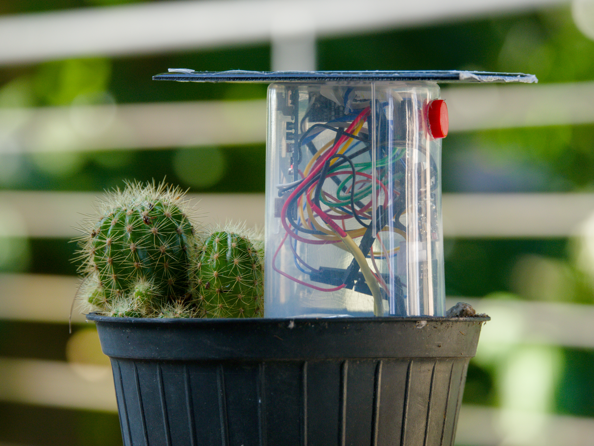

# Smart Soil Condition Monitoring

An ESP32-powered system for healthier plants and more precise care.

> Sense the environment. Respond with confidence.



## About MorAura

Monitoring plants is a tedious, labour-intensive task. Consistent monitoring can reduce the likelihood of plants dying out and may improve crop yield.

MorAura is designed to monitor plant conditions and help keep them within ideal ranges, reducing guesswork and the need for constant human monitoring.

## Project Goals

- Accurately measure plant conditions.
- Reduce guesswork in plant care.
- Reduce the need for constant human monitoring.

## System Architecture

The firmware has three development tracks:

```text
Sensors ──> ESP32
             ├── Version 1: BLE ──> Android app
             ├── Version 1.5 (experimental): BLE + Wi-Fi ──> ntfy.sh alerts ──> Android notifications
             │                              └── external pushbutton wakes BLE setup mode
             └── Version 2 (in progress): Wi-Fi ──> local logging / planned server
```

Version 1.5 builds on the Version 1 sensor and BLE prototype. The firmware checks moisture and temperature thresholds, posts alerts to ntfy.sh over Wi-Fi, and uses deep sleep between sensor cycles. An external pushbutton wakes the device into a BLE setup window. The Android app can configure the device over BLE and listen for its ntfy.sh alerts.

### Sensors

- Soil moisture
- Light intensity
- Temperature

## Example Monitoring Profile

The following values are illustrative targets for the prototype. They should be calibrated for the plant species and real growing environment.

| Condition | Example target range |
| --- | --- |
| Soil moisture | 40–65% |
| Light | 1,000–10,000 lux |
| Temperature | 20–28°C |

The Version 1.5 firmware compares moisture and temperature readings with configured limits, indicates out-of-range readings with the onboard LED, and attempts to send an ntfy.sh alert.

## Build and Field Test Plan

1. Research the problem and suitable sensors. (Complete)
2. Develop the first ESP32 firmware and Android BLE app. (Implemented; hardware validation and calibration remain ongoing.)
3. Extend Version 1 with Wi-Fi alerts and BLE Wi-Fi credential setup in Version 1.5. (Implemented experimentally; hardware validation remains ongoing.)
4. Develop Wi-Fi data logging and server communication in Version 2. (In progress.)
5. Visit plantations to survey users and collect feedback. (Planned.)
6. Calibrate the monitoring ranges and test the system at real plantation sites. (Planned.)

The field visits will help confirm that the system is practical for real-world scenarios.

## Repository Structure

```text
.
├── README.md
├── Android_Apps/
│   └── SoilApp/             # Android app (Kotlin, Jetpack Compose)
└── Sensor_Code/
    ├── Code_v1/Code_v1.ino       # BLE firmware
    ├── Code_v1.5/Code_v1.5.ino   # BLE + Wi-Fi/ntfy prototype
    └── Code_v2/Code_v2.ino       # Wi-Fi and local logging work in progress
```

## Getting Started

### Version 1: BLE Prototype

The Android project is in [`Android_Apps/SoilApp/`](Android_Apps/SoilApp/). Open that directory in Android Studio to build and run the app on an Android device with BLE support. The ESP32 BLE firmware is [`Sensor_Code/Code_v1/Code_v1.ino`](Sensor_Code/Code_v1/Code_v1.ino); open it in an Arduino-compatible ESP32 development environment, select the matching board, and flash it to the board.

The firmware currently reads soil moisture on `A3`, light on `A2`, and temperature from the ESP32's internal temperature sensor. Confirm the pin mapping and board support for the specific ESP32 before wiring or flashing. The internal temperature sensor is being used for testing and may not represent ambient plant temperature accurately.

The app can scan for the `SoilSense` BLE service, show live moisture, temperature, and light readings, plot received history, and configure minimum and maximum moisture and temperature thresholds. The firmware keeps up to 168 samples for each metric and sends those histories to the app over BLE. Light is currently mapped to a 0–100 sensor scale, not converted to calibrated lux; the app labels this value provisionally. The app requires Android 13 or later and Bluetooth and notification permissions.

The app also runs a foreground service to listen for ntfy.sh alerts and display Android notifications. When it reads a device's BLE identifier, it saves that device's alert topic locally in a Room database, so the listener can subscribe to topics for previously connected devices. The Settings screen also supports renaming the device and sending Wi-Fi credentials to it over BLE.

### Version 1.5: BLE, Wi-Fi, and ntfy.sh (Experimental)

The experimental firmware is [`Sensor_Code/Code_v1.5/Code_v1.5.ino`](Sensor_Code/Code_v1.5/Code_v1.5.ino). It advertises the `SoilSense` BLE service and supports BLE configuration of moisture and temperature limits, Wi-Fi credentials, and the device name. The Android Settings screen provides controls for the device name and Wi-Fi credentials. On an out-of-range moisture or temperature reading, the firmware lights the onboard LED and attempts to post an alert to an ntfy.sh topic derived from the device ID. The Android app listens to the corresponding topics and displays notifications.

The firmware uses deep sleep between sensor cycles and can be woken by an external pushbutton into a BLE setup window. Wi-Fi credentials are held in RTC-retained memory by this prototype and are not saved across a full power loss.

ntfy.sh topics are public, and the firmware currently sends alerts over unencrypted HTTP. Treat this as prototype behavior only; do not send private information or rely on it as a production notification channel.

### Version 2: Wi-Fi and Server (In Progress)

The current Wi-Fi sketch is [`Sensor_Code/Code_v2/Code_v2.ino`](Sensor_Code/Code_v2/Code_v2.ino). It averages sensor readings, synchronizes time using NTP, and appends timestamped readings to a local LittleFS file. The server synchronization function is currently a placeholder; end-to-end upload and server integration are not implemented yet. Configure Wi-Fi credentials locally before testing, and do not commit real credentials.

The Android app currently communicates over BLE; Wi-Fi/server connectivity is not part of the app yet.

### Parts List

The following parts list is based on the project BOM in [PartsList.pdf](PartsList.pdf).

| Item | Cost | Link |
| --- | ---: | --- |
| ESP32 board | 850.00 | MD0929 - SuperMini ESP32-C3 Dev Board Type-C WiFi Bluetooth IoT |
| Charging Module | 350.00 | Mini Solar Battery Charging Module LiPo CN3065 Input 4.4-6V Out 500mA (MD0397) Products |
| Solar Panel | 280.00 | BA0146 - Mini Solar Panel 5V 200mA 99x69mm |
| LiPo Boost | 150.00 | MD0745 - Multi-function Mini Boost Module Step Up Board 5/8/9/12V 1.5A |
| Soil moisture | 330.00 | Capacitive Soil Moisture Sensor V2.0 (MD0751) Products |
| Lipo Battery | 530.00 | 3.7V 250mAh Lipo Battery (BA0149) Products |
| Light sensor | 350.00 | MD0249 - TEMT6000 Professional Light Sensor Module |
| Total Cost | 2,840.00 | - |

## Status

Version 1 has an ESP32 BLE firmware sketch and an Android app that receives sensor data and supports threshold configuration. Version 1.5 is an experimental extension with BLE device and Wi-Fi setup, Wi-Fi-based ntfy.sh alerts, and deep-sleep operation; the Android app stores device alert topics locally and displays incoming alerts through a foreground listener service. These notification and power-management features still need hardware validation, and ntfy.sh delivery is not suitable for private or production use in its current form. Version 2 has early Wi-Fi, NTP time synchronization, and LittleFS logging code; sending data to a server is the next implementation step. Sensor calibration and field testing remain outstanding.

## Team

MorAura team project.
